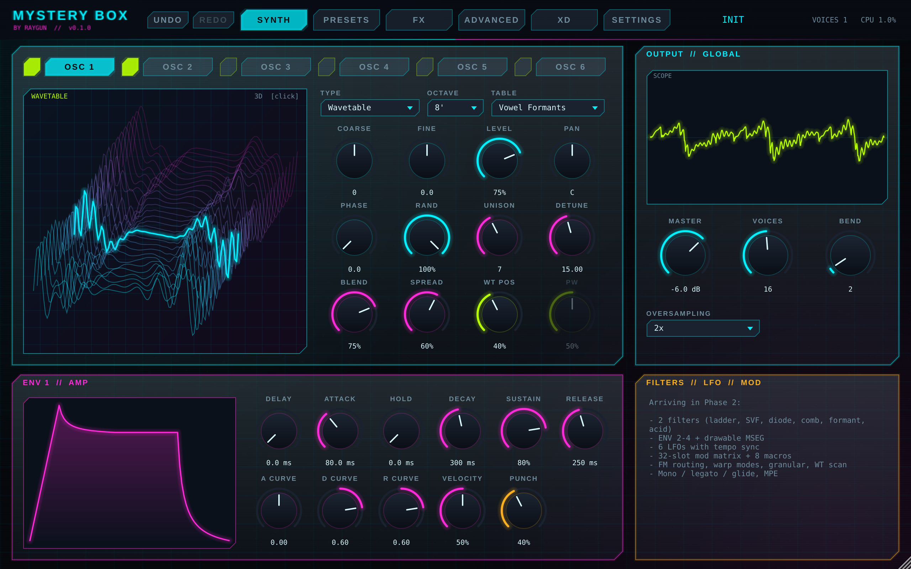

# Mystery Box by Raygun

A 6-oscillator cyberpunk software synthesizer: VST3, AU and Standalone (CLAP planned) for
Windows 10/11 x64 and macOS 12+ (Universal), built with JUCE 8 / C++20 / CMake.



> **Status: Phase 1 of 7 complete.** See [docs/ROADMAP.md](docs/ROADMAP.md) for what works now
> and what is next. A rendered demo is in [docs/media/phase1-demo.wav](docs/media/phase1-demo.wav).

## Building

Requirements: CMake 3.22+, a C++20 compiler, Git. JUCE 8.0.4 is fetched automatically
(or point `-DMYSTERYBOX_JUCE_DIR=/path/to/JUCE` at a local checkout).

### macOS (Universal Binary: Apple Silicon + Intel)

Xcode 15+ is required.

```bash
cmake -B build -G Xcode -DCMAKE_OSX_ARCHITECTURES="arm64;x86_64"
```

```bash
cmake --build build --config Release
```

Outputs are under `build/MysteryBox_artefacts/Release/{VST3,AU,Standalone}`. To use them, copy
`Mystery Box.vst3` to `~/Library/Audio/Plug-Ins/VST3` and `Mystery Box.component` to
`~/Library/Audio/Plug-Ins/Components`. Then validate the AU:

```bash
auval -v aumu MyBx Rygn
```

### Windows 10/11 (x64)

Visual Studio 2022 with the "Desktop development with C++" workload is required.

```bash
cmake -B build -G "Visual Studio 17 2022" -A x64
```

```bash
cmake --build build --config Release
```

Copy `build\MysteryBox_artefacts\Release\VST3\Mystery Box.vst3` to `C:\Program Files\Common Files\VST3`.

### Linux (development / CI)

```bash
cmake -B build -G Ninja -DCMAKE_BUILD_TYPE=Release
```

```bash
cmake --build build
```

## Tests

```bash
./build/MysteryBoxTests_artefacts/Release/MysteryBoxTests
```

The suite covers band-limiting and aliasing, pitch accuracy, envelope timing, click-free
voice stealing, unison level, sample-accurate MIDI, full state round-trip, zero heap
allocations in `processBlock`, and the CPU budget. Extra modes:
`MysteryBoxTests --render out.wav` writes a demo phrase, and
`MysteryBoxTests --screenshot out.png [tab] [osc]` writes a 2x UI capture.

CI (`.github/workflows/build.yml`) builds on macOS (Universal), Windows and Linux, runs the
tests, runs pluginval at strictness 10, and runs auval on macOS.

## Source layout

| Path | Contents |
|---|---|
| `src/dsp/` | JUCE-free, allocation-free DSP: oscillators, wavetables, envelopes, voice engine |
| `src/params/` | The single parameter table (IDs, ranges, defaults) and lock-free audio-thread cache |
| `src/ui/` | Theme, neon LookAndFeel, bound widgets, displays |
| `src/PluginProcessor.*` | Host glue: MIDI, oversampling, state, metering taps |
| `src/PluginEditor.*` | Scalable 1280x800 vector UI with the 6 top-bar tabs |
| `tests/` | Unit tests, demo renderer, screenshot tool |

## State-compatibility rules

Parameter IDs never change after release, and choice lists are append-only. New parameters
use a higher `ParameterID` version hint. Every one of these rules protects saved DAW projects.
